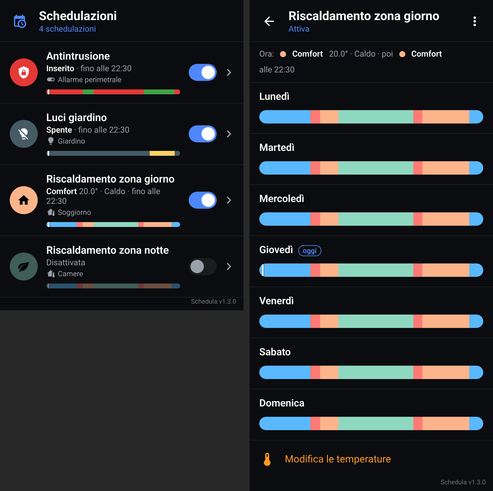
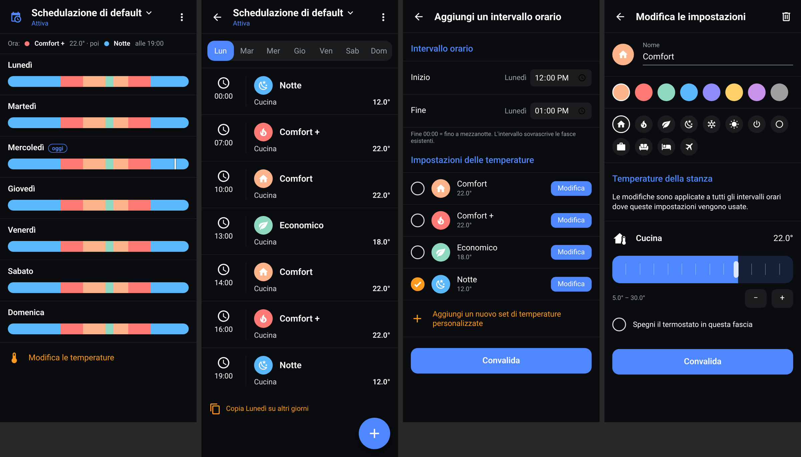

<p align="center"></p>

# Schedula – Programmatore settimanale per Home Assistant





Programmatore settimanale **generico** per Home Assistant, con card in stile cronotermostato: riscaldamento, raffrescamento, luci, antintrusione (tramite switch/input_boolean), tapparelle… Scegli un'entità, crea delle **impostazioni** (es. Comfort 22°, Inserito, Acceso) e assegnale a **fasce orarie** per ogni giorno della settimana.

## Tipi di impianto
Quando aggiungi l'integrazione scegli il **tipo di impianto** e poi i dettagli. Schedula prepara le impostazioni (icone, colori e valori) e un **programma settimanale tipico**, che poi modifichi dalla card.

| Tipo | Dettagli | Impostazioni preparate |
|---|---|---|
| **HVAC** | Riscaldamento / Raffrescamento / Caldo e freddo · Radiatori, Pavimento, Soffitto radiante, Fan coil, Split · Abitazione, Ufficio, Negozio | Comfort, Comfort +, Economico, Notte (o Spento per split e fan coil in raffrescamento). Temperature e anticipo di accensione adatti ai terminali: per esempio 2 ore per il pavimento, 1 ora per i radiatori |
| **Luci** | Interne, Esterne, Giardino, Vetrine · utilizzo | Accese (lampadina accesa, giallo) e Spente (lampadina spenta, grigio) |
| **TVCC** | Interne, Esterne · utilizzo | Registrazione attiva e Non attiva |
| **Antintrusione** | Totale, Perimetrale, Solo notte · utilizzo | Inserito e Disinserito, tramite switch o input_boolean |
| **Tapparelle** | utilizzo | Aperte, A metà, Chiuse |
| **Irrigazione** | Prato, Orto, Goccia | Irrigazione e Ferma |
| **Ventilazione / VMC** | utilizzo | Attiva e Spenta |
| **Acqua calda sanitaria** | utilizzo | Comfort 50° ed Economico 40° (oppure Acceso/Spento) |
| **Altro** | — | Impostazioni generiche in base all'entità |

## Entità supportate
| Dominio | Cosa imposta l'impostazione |
|---|---|
| `climate` | temperatura e modalità per ogni impostazione (Caldo, Freddo, Auto, Spento…) |
| `water_heater` | temperatura (oppure *Spento*) |
| `input_number`, `number` | valore numerico |
| `cover` | posizione 0–100 % |
| `input_select`, `select` | opzione |
| `valve` | aperta / chiusa |
| `switch`, `light`, `fan`, `input_boolean`, `camera`, `automation`, `siren`, `humidifier`, `script`, `group` | acceso / spento |

## Installazione con HACS (consigliata)
[](https://my.home-assistant.io/redirect/hacs_repository/?owner=AleRube&repository=HA-ScheduleCard&category=integration)

1. Premi il pulsante qui sopra. In alternativa vai in HACS → ⋮ → *Repository personalizzati*, incolla `https://github.com/AleRube/HA-ScheduleCard` e scegli il tipo **Integrazione**.
2. Scarica **Schedula** e riavvia Home Assistant.

[](https://my.home-assistant.io/redirect/config_flow_start/?domain=schedula)

## Installazione manuale
1. Copia la cartella `custom_components/schedula` in `/config/custom_components/`.
2. Riavvia Home Assistant.

## Configurazione
1. **Impostazioni → Dispositivi e servizi → Aggiungi integrazione → Schedula**. Scegli il tipo di impianto, poi i dettagli, il nome e l'entità da comandare. Puoi creare più schedulazioni, per esempio una per zona.
2. In una dashboard aggiungi la card **Schedula**: matita → *Aggiungi scheda* → cerca "Schedula". Nell'editor della card scegli:
   - il **tipo di impianto**, per esempio solo HVAC o solo Luci;
   - quali **schedulazioni** mostrare. Se non ne spunti nessuna, compaiono tutte quelle del tipo scelto, anche quelle create in futuro.

   Così puoi farti una plancia per il riscaldamento, una per le luci e così via. In YAML:

```yaml
type: custom:schedula-card
title: Riscaldamento
category: hvac          # facoltativo: hvac, luci, tvcc, antintrusione, tapparelle, irrigazione, ventilazione, acs, altro
entities:               # facoltativo: elenco esplicito
  - sensor.riscaldamento_zona_giorno
  - sensor.riscaldamento_zona_notte
idle_timeout: 120       # facoltativo: secondi prima di tornare all'elenco (0 = mai)
```

La prima pagina è l'**elenco**: per ogni schedulazione mostra l'impostazione in corso, fino a che ora vale, la barra di oggi e l'interruttore per attivarla o disattivarla. Toccandone una si apre la settimana. Con `entity: sensor.xxx` al posto di `entities` la card apre direttamente la settimana di quella schedulazione.

La card viene caricata automaticamente dall'integrazione: non serve aggiungere risorse a mano. Se dopo un aggiornamento vedi ancora la versione vecchia, svuota la cache del browser/app.

## Come funziona
- **Settimana**: barre colorate per ogni giorno, con l'indicatore dell'ora attuale. Tocca un giorno per aprirlo.
- **Giorno**: elenco delle fasce con inizio e fine. Con **+** aggiungi un orario: l'inizio è proposto dove finisce l'orario precedente all'ultimo, con durata di 1 ora. Tocca una fascia per modificarla o eliminarla. Da qui puoi anche **copiare il giorno** su altri giorni.
- **Orari collegati**: se cambi l'inizio di un orario, si sposta la fine di quello prima. Se cambi la fine, si sposta l'inizio di quello dopo.
- **Ora a mano**: tocca le cifre di ore o minuti per scriverle. L'icona dell'orologio apre il selettore.
- **Impostazioni**: nome, colore, icona e valore. Tra i simboli ci sono lampadine accese e spente e antintrusione inserito e disinserito. Le icone usano il nero sui colori chiari e il bianco su quelli scuri. Se modifichi un'impostazione, cambia in tutte le fasce che la usano.
- Dopo **2 minuti** senza modifiche la card torna alla schermata principale. Si può cambiare con `idle_timeout` (secondi, `0` = mai).
- **Menu ⋮**: attiva/disattiva, applica ora, **cambia entità comandata**, copia giorno.
- **Cambio entità**: se ti accorgi di aver scelto la variabile sbagliata, cambiala dal menu ⋮ oppure da *Configura* nell'integrazione. Vengono proposte solo entità dello stesso tipo, così impostazioni e orari restano uguali.

All'inizio di ogni fascia viene applicato il valore. Se nel frattempo cambi il termostato a mano, la modifica resta valida fino alla fascia successiva.

## Entità create
- `sensor.<nome>`: impostazione in corso. Negli attributi ci sono valore, prossimo cambio, programma e `schedule_id`.
- `switch.<nome>_attiva`: attiva o disattiva la schedulazione.

## Opzioni (Configura)
- Cambio dell'entità da comandare.
- **Modalità HVAC predefinita**, usata per le impostazioni che hanno "Non modificare".
- Applicazione dell'impostazione all'avvio di Home Assistant.

## Servizi
- `schedula.save`: `schedule_id`, `presets`, `week`. È il servizio usato dalla card.
- `schedula.set_enabled`: `schedule_id`, `enabled`.
- `schedula.apply_now`: `schedule_id`.
- `schedula.set_target`: `schedule_id`, `entity_id`. Cambia l'entità mantenendo il programma, solo se è dello stesso tipo.

Richiede Home Assistant 2024.11 o successivo. L'icona dell'integrazione compare da Home Assistant 2026.3 in poi (cartella `brand/`).

## Sviluppo
```bash
pip install pytest-homeassistant-custom-component
python -m pytest -q
```
